# 1. The problem

Paste a trace ID into Kibana, and Elasticsearch finds it among millions of log lines almost instantly. How?

The secret: full-text search engines like Elasticsearch and OpenSearch **do not read every line**. They stand on the same basic idea:

- An **inverted index**: a map from each word to the lines that contain it, so we can jump straight to the matching lines.
- A **relevance score** such as **TF-IDF**: a formula that decides which of those lines matter most. (Elasticsearch uses BM25 today, a close cousin of TF-IDF.)

# 2. The naive way: scan every line

The easiest way is to open the file, walk through every line and keep the lines that contain all words of the query:

```rust
for line in file_content.lines() {
    let line_tokens: HashSet<String> = analyzer(line).into_iter().collect();
    if query_tokens.iter().all(|t| line_tokens.contains(t)) {
        search_result.push(line.to_string());
    }
}
```

It works, but it always takes about **1.7 seconds**, no matter which word we search. Every search reads and splits all 135 MB again, and the results have no ranking: a line that matches is just a line that matches.

To do better we need two things:

- A way to **rank** lines: which line is the most relevant? That is **TF-IDF**.
- A way to **skip** lines that cannot match without reading them. That is the **inverted index**.

# 3. How TF-IDF works

Imagine a team meeting. Everyone says "ok" all the time, so hearing "ok" tells you nothing. But if one person says "outage" three times, that is the person you listen to.

TF-IDF scores log lines the same way, by asking two questions about each word:

- **TF**: how often does the word appear **in this line**?
- **IDF**: how rare is the word **across all lines**?

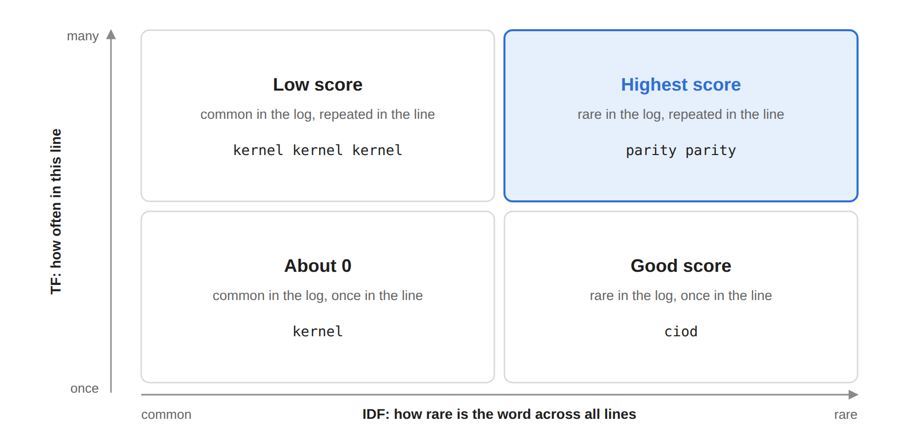

A line ranks highest when a word is repeated in it **and** rare everywhere else. Let's look at each piece.

## 3.1 Analyzer: turning a line into words

Before counting anything, every line and every query is cut into words by the same `analyzer`:

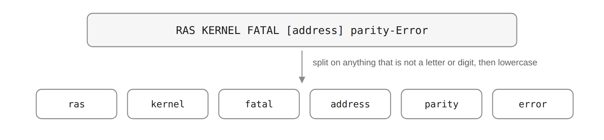

```rust
fn analyzer(doc: &str) -> Vec<String> {
    doc.split(|c: char| !c.is_alphanumeric())
        .filter(|token| !token.is_empty())
        .map(|token| token.to_lowercase())
        .collect()
}
```

Both sides **must** use the same analyzer, otherwise `Error` in a query would never match `error` in the index. From now on, each log line is a **document** (doc) and each word is a **term**.

## 3.2 TF: how often in this line

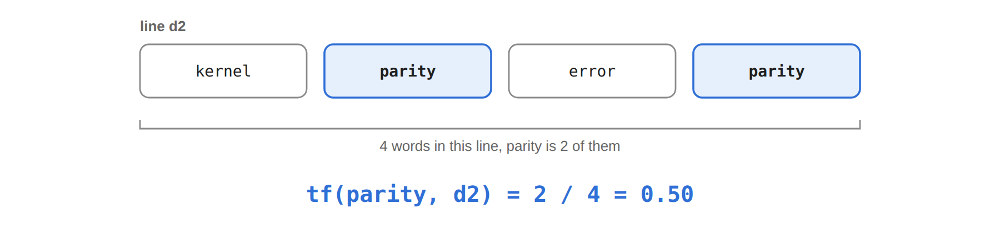

```text
tf(term, doc) = (times term appears in doc) / (total words in doc)
```

We divide by the line length so that a long line does not win just because it has more words.

## 3.3 IDF: how rare across all lines

First we need **DF** (document frequency): **in how many lines does the word appear?** We do not count how many times the word is written, only how many lines have it. A line that contains the word twice still counts once.

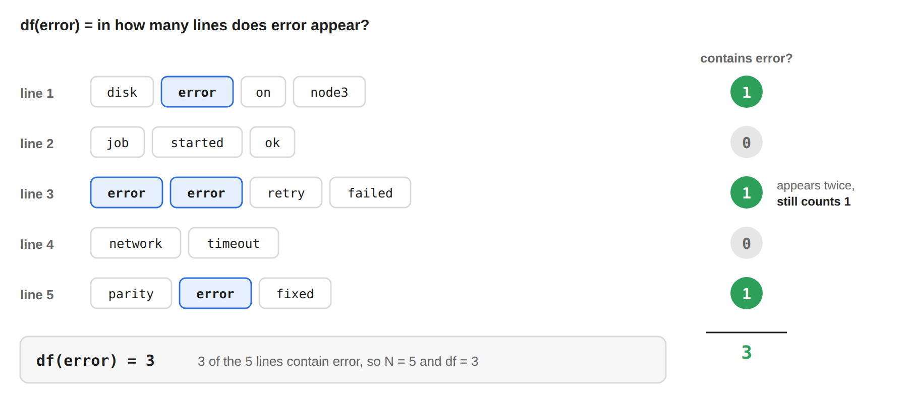

Then **IDF** turns DF into "how rare", with `N` the total number of lines:

```text
idf(term) = ln(N / df(term))
```

A word in every line gets `ln(N / N) = 0`. A word in only one line gets the highest idf:

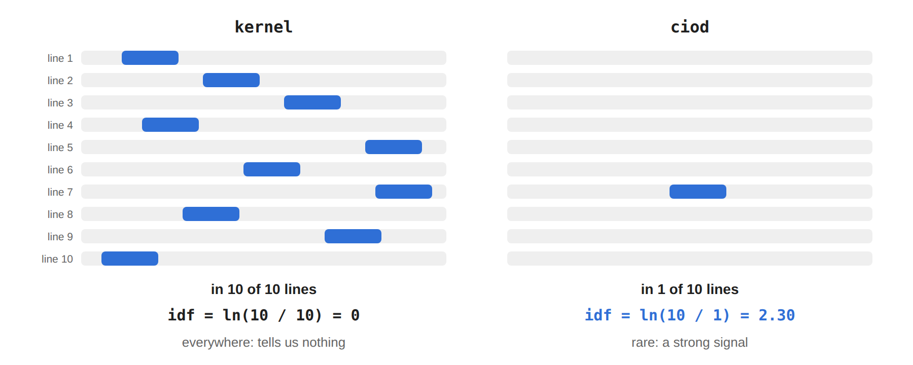

`ln` keeps the numbers small: a word 1,000 times rarer scores higher, but not 1,000 times higher. On our real 1 million lines:

| Word | df (of 1,000,000 lines) | idf |
| --- | --- | --- |
| `kernel` | 987,848 | 0.012 |
| `ciod` | 16,996 | 4.07 |

## 3.4 The score

For each word, we **multiply** its tf by its idf:

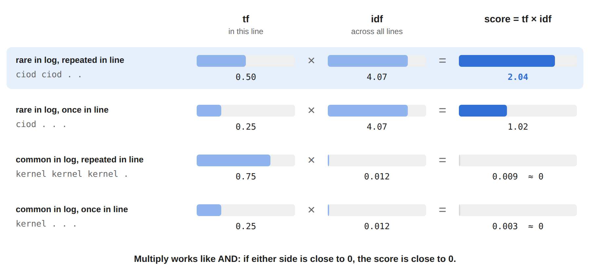

Multiplying works like an **AND**: a line only scores high when it repeats the word **and** the word is rare. `kernel kernel kernel` repeats a lot, but `kernel` is everywhere, so its score is still about 0.

```text
score(doc, query) = sum of tf(term, doc) × idf(term) over the query words
```

For a query with several words, each word adds its own `tf × idf` to the line's score. We will see it in the example below.

> One limit: tf grows without a cap, so a word repeated 10 times gets 10 times the boost. Elasticsearch's BM25 makes tf **saturate** instead: each extra repeat adds less and less.

## 3.5 A worked example

Let's take 3 tiny documents and build everything by hand:

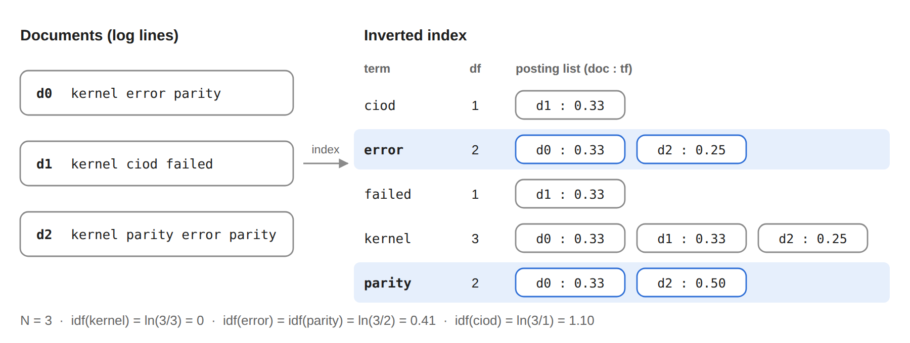

On the left are the documents. On the right is the **inverted index**: for each term, its df and its **posting list**, the list of `(doc, tf)` pairs where it appears. With `N = 3`:

- `kernel` is in all 3 docs, so `idf = ln(3/3) = 0`.
- `error` and `parity` are in 2 docs, so `idf = ln(3/2) = 0.41`.

Now we search `parity error`. We only read the two highlighted rows, never the documents themselves, and add up each word's `tf × idf`:

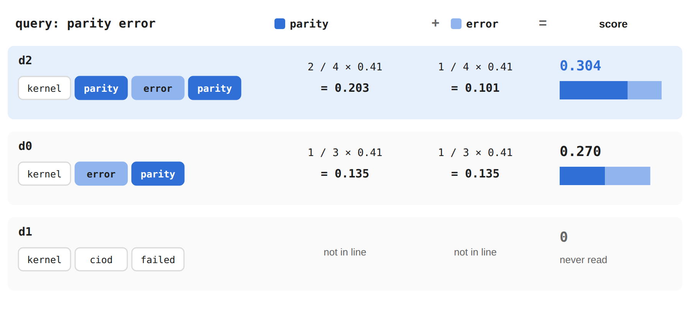

`d2` wins because `parity` appears twice in it. `d1` is never touched at all: it is not in either posting list. That is the whole trick of the inverted index. **We only look at lines that can match.**

# 4. Implementing it in Rust

## 4.1 Indexing: compute TF and DF once

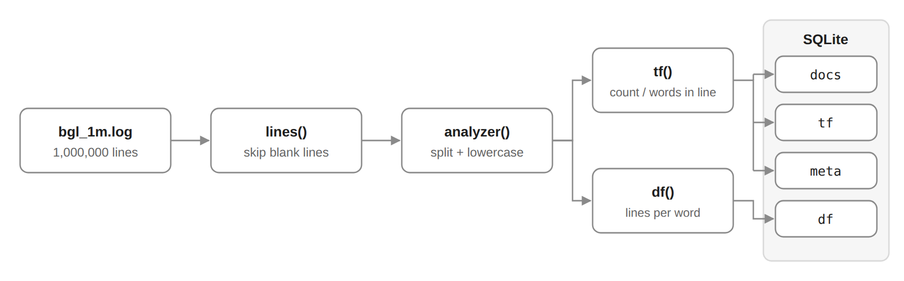

The `index` command reads the file once, skips blank lines (otherwise `N` is wrong), and passes every line to `tf()` and `df()`. `lines()` also strips the `\r` of Windows line endings for us.

```rust
let file_content = read_to_string(path_arg).unwrap();
let docs_vec: Vec<&str> = file_content
    .lines()
    .filter(|l| !l.trim().is_empty())
    .collect();

tf(&docs_vec);
df(&docs_vec);
```

### 4.1.1 TF

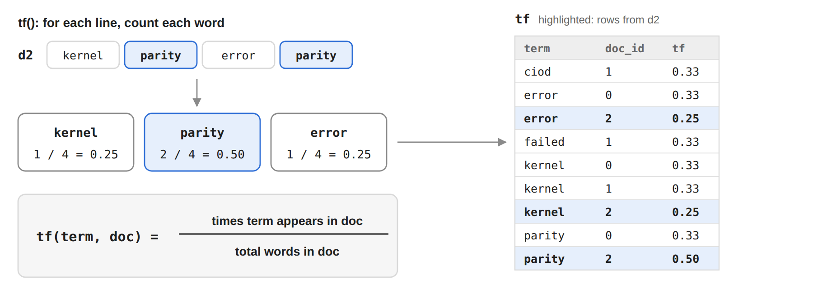

`tf()` counts each word of a line and stores one value per `(term, doc_id)` pair. The `doc_id` is just the line index:

```rust
fn tf(docs: &[&str]) -> HashMap<(usize, String), f64> {
    let mut result = HashMap::new();
    for (index, doc) in docs.iter().enumerate() {
        let tokens = analyzer(doc);
        for word in &tokens {
            let count = tokens.iter().filter(|c| *c == word).count();
            result.insert((index, word.clone()), count as f64 / tokens.len() as f64);
        }
    }
    db::save_tf(db::DB_PATH, docs, &result).unwrap();
    result
}
```

### 4.1.2 DF

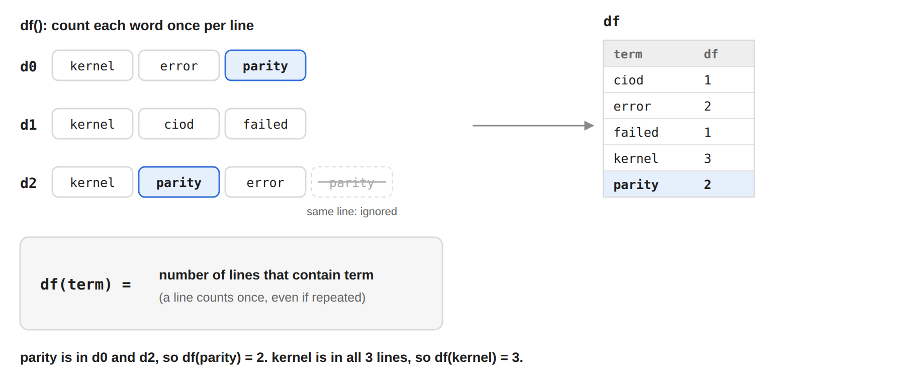

`df()` puts the words of each line in a `HashSet` first, so a word repeated in one line is only counted once:

```rust
fn df(docs: &[&str]) -> HashMap<String, usize> {
    let mut result = HashMap::new();
    for doc in docs {
        let tokens: HashSet<String> = analyzer(doc).into_iter().collect();
        for word in tokens {
            *result.entry(word).or_insert(0) += 1;
        }
    }
    db::save_df(db::DB_PATH, &result).unwrap();
    result
}
```

Notice we do **not** store idf. It depends on `N` and `df`, which change every time logs are added or removed. If we stored idf, every new line would force us to rewrite millions of rows. Computing `ln(N / df)` at search time costs nothing.

## 4.2 Storing the inverted index in SQLite

We keep the index in one SQLite file, `data/search_index.db`, with 4 tables. Here is what they hold for our 3-line example, and how a search for `parity` uses them:

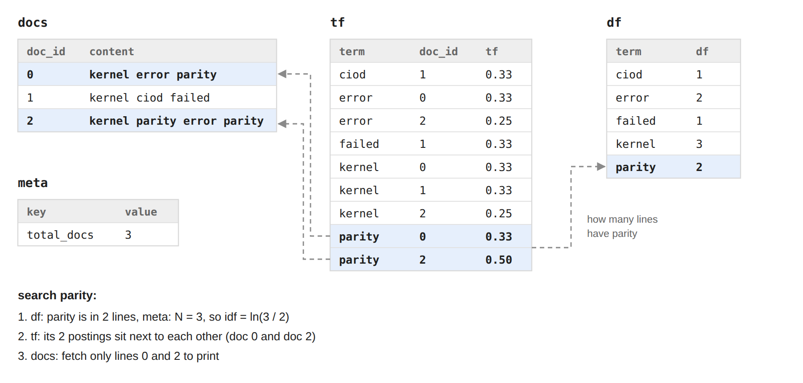

The schema:

```sql
-- the original log lines, to print results
CREATE TABLE docs (doc_id INTEGER PRIMARY KEY, content TEXT NOT NULL);

-- the posting lists: one row per (term, doc)
CREATE TABLE tf (
    term   TEXT    NOT NULL,
    doc_id INTEGER NOT NULL,
    tf     REAL    NOT NULL,
    PRIMARY KEY (term, doc_id)
) WITHOUT ROWID;

-- number of lines containing each term
CREATE TABLE df (term TEXT PRIMARY KEY, df INTEGER NOT NULL) WITHOUT ROWID;

-- index-wide values, here N
CREATE TABLE meta (key TEXT PRIMARY KEY, value INTEGER NOT NULL);
```

For 1 million lines that is 1,000,000 docs, 21,266,252 `tf` rows, 764,166 terms, and a 1.1 GB file built in 55 seconds.

## 4.3 Searching

The whole search, at a glance:

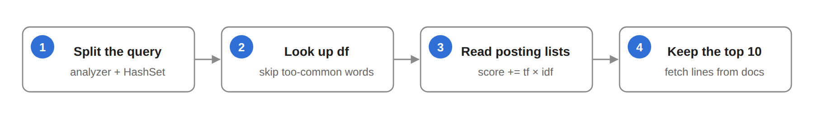

Let's follow a real query, `Kernel parity error`, step by step on our 1 million lines. The whole search takes about 52 ms.

### Step 1: split the query

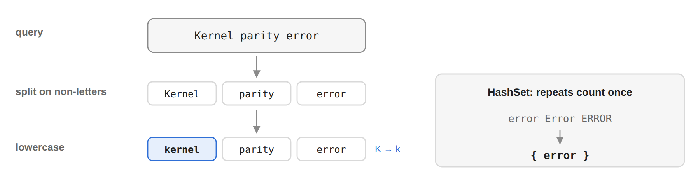

The query goes through the **same analyzer** as the log lines, so `Kernel` becomes `kernel` and matches the index. We collect the words in a `HashSet`, so a word typed twice is only looked up once.

```rust
let tokens: HashSet<String> = analyzer(value).into_iter().collect();
```

### Step 2: look up df, skip words that are too common

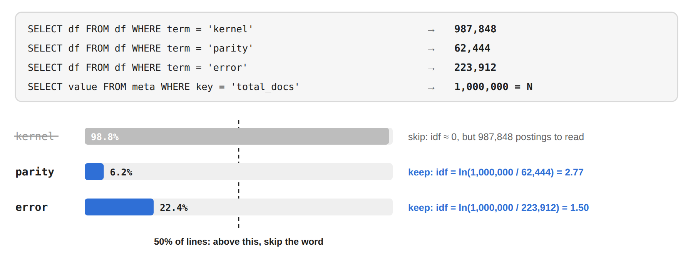

For each word, one small lookup in the `df` table, plus `N` from the `meta` table. That is all we need for idf. A word that is not in the index at all (`None`) is dropped right away.

`kernel` is in 98.8% of the lines. Its idf is almost 0, so it barely changes any score, but reading its 987,848 postings would take most of the time. So we skip any word found in more than 50% of the lines. If **every** query word is that common, we keep the rarest one so there are still results.

```rust
let total_docs = total_docs(&conn).expect("Query total docs failed");

let mut terms: Vec<(String, i64)> = Vec::new();
for token in tokens {
    match get_df(&conn, &token).expect("Query df failed") {
        Some(df) => terms.push((token, df)),
        None => continue, // not in the index: no line contains it
    }
}

let (mut kept, common): (Vec<_>, Vec<_>) = terms
    .into_iter()
    .partition(|(_, df)| (*df as f64 / total_docs as f64) <= MAX_DF_RATIO); // 0.5
if kept.is_empty() {
    if let Some(rarest) = common.into_iter().min_by_key(|(_, df)| *df) {
        kept.push(rarest);
    }
}
```

### Step 3: read the posting lists, add up the scores

The **posting list** of a word is simply all the rows of the `tf` table for that word: one row for each line that contains it, with its `tf`.

```sql
SELECT doc_id, tf FROM tf WHERE term = 'parity';  -- 62,444 rows
```

Each word also has its idf, computed from the `df` we read in step 2:

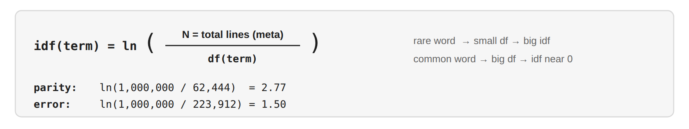

We keep a `scores` map, `doc_id → score`, and go through the rows one by one. Each row does one thing: **`scores[doc_id] += tf × idf`**.

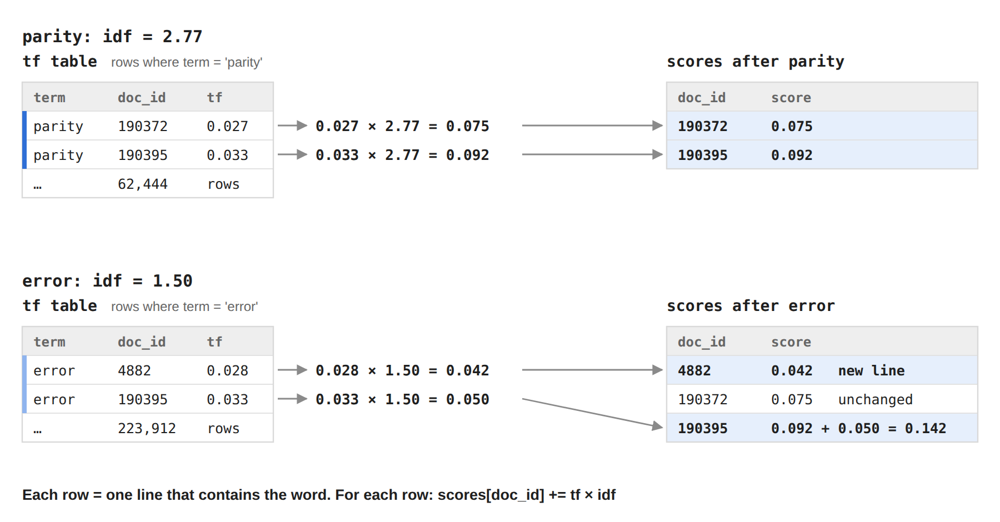

- **First `parity`:** line `190372` gets `0.075`, line `190395` gets `0.092`.
- **Then `error`:** line `190395` is already in the map, so its score grows to `0.142`. Line `4882` is new, so it is added with `0.042`. Line `190372` has no `error`, so it stays the same.

A line that contains both words collects points twice, so it rises to the top. A line that contains none of the words never shows up in `scores` at all.

```rust
let mut scores: HashMap<i64, f64> = HashMap::new();       // doc_id -> score
for (token, token_df) in kept {
    let idf = (total_docs as f64 / token_df as f64).ln();
    for (doc_id, tf) in get_tf(&conn, &token).expect("Query tf failed") {
        *scores.entry(doc_id).or_insert(0.0) += tf * idf;  // start at 0, then add
    }
}
```

### Step 4: sort, keep the top 10, fetch the lines

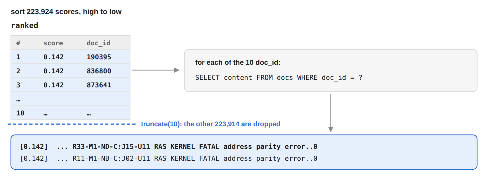

We sort all scores from high to low and keep only the first 10. Scores are `f64`, which has no `Ord` (because of `NaN`), so we sort with `total_cmp`. Only now do we touch the `docs` table, and only for those 10 lines.

```rust
let mut ranked: Vec<(i64, f64)> = scores.into_iter().collect();
ranked.sort_by(|a, b| b.1.total_cmp(&a.1));
ranked.truncate(10);

for (doc_id, score) in ranked {
    if let Some(content) = get_doc(&conn, doc_id).expect("Query doc failed") {
        println!("[{:.3}] {}", score, content);
    }
}
```

# 5. Benchmark

Same 4 queries, same 1 million lines, with and without the index (`--release` build, median of 5 runs):

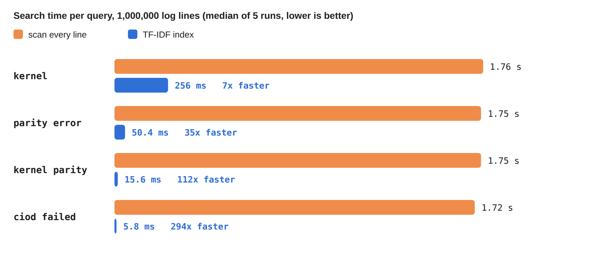

Scanning every line always takes about **1.75 s**. With the TF-IDF index, the same searches take **6 ms to 256 ms**, that is **7x to 294x faster**.

# Conclusion

- **Inverted index:** for each word, the list of lines that contain it. A search only reads those lists, never the whole file.
- **TF-IDF:** a line ranks high when it repeats a word that is rare everywhere else.
- **Speed** depends on how rare the words are: rare words have short lists and answer in milliseconds.

That is the same idea behind Elasticsearch, just much smaller. Index smart, not hard!

# Ref

- Source code of `rlog`: [github.com/HaPhanBaoMinh/rust/tree/main/rlog](https://github.com/HaPhanBaoMinh/rust/tree/main/rlog)
